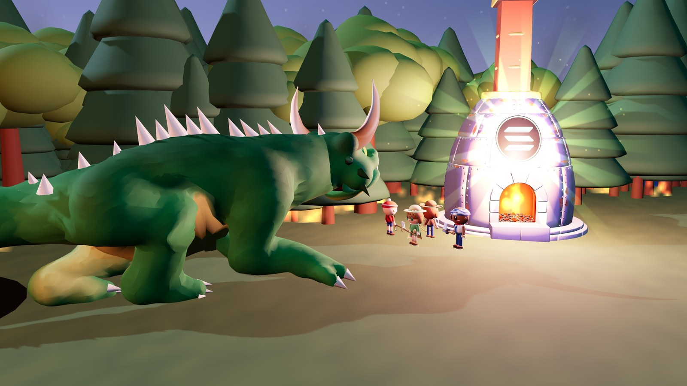

# Welcome to Hodag Isles

**Paul Bunyan's crew cut the wrong tree, and the Great Hodag woke up.**

The beast burned the boats and ringed the isles with fire. The only thing it fears is the purple-to-green glow of the camp's giant stove, so the crew keeps feeding it, day and night.

**Hodag Isles** is a free multiplayer game you play in your browser, on **Solana**. No download, no install: you wash ashore, grab a log and join the crew.

> **Keep the stove roaring. The Hodag is watching.**

## What you do on the isles

* 🪓 **Feed the Big Stove** with logs, bundles and coal, together with everyone in the room.
* 🤠 **Choose your hero:** Lumberjack, Wrangler, Sower or Steel Driver.
* ⚔️ **Duel other loggers** in Big Ole's Brawl Pit.
* 🔥 **Train, then fight the Great Hodag** with your crew.
* 🎣 **Fish, swim, explore** the isles and meet the legends of American folklore.

## Built on Solana

* Sign in with your **Solana wallet** (one free signature, nothing is sent).
* The **TimberPass** season pass is paid in **SOL**.
* **$HODAG**, the camp's coin, launches on **Solana**.

## Start here


[The Tall Tale](story/the-tale.md)



[Getting Started](play/getting-started.md)



[The Hodag Coin](token/hodag.md)

