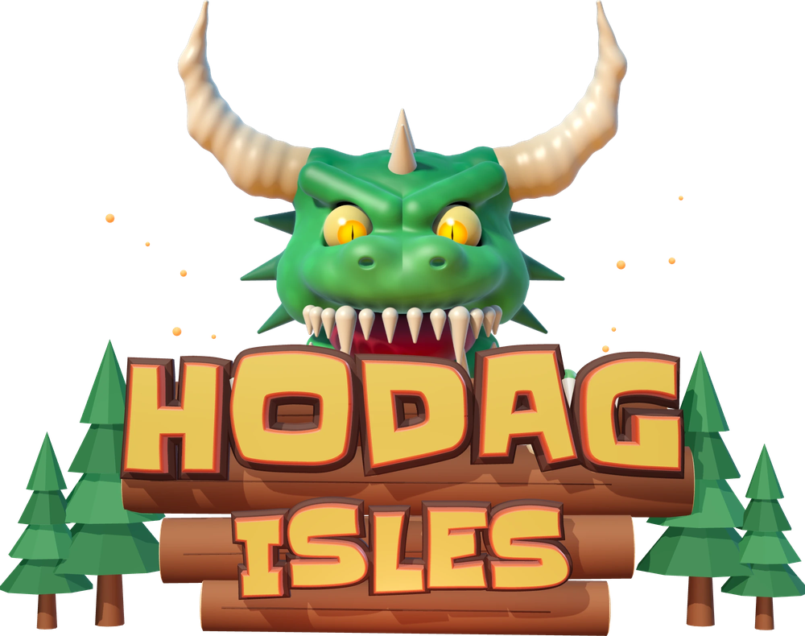
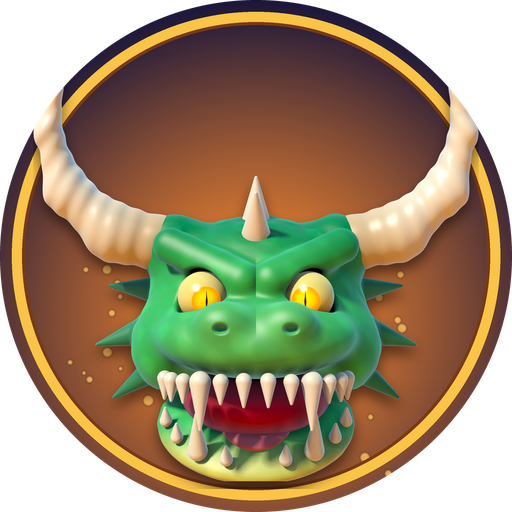
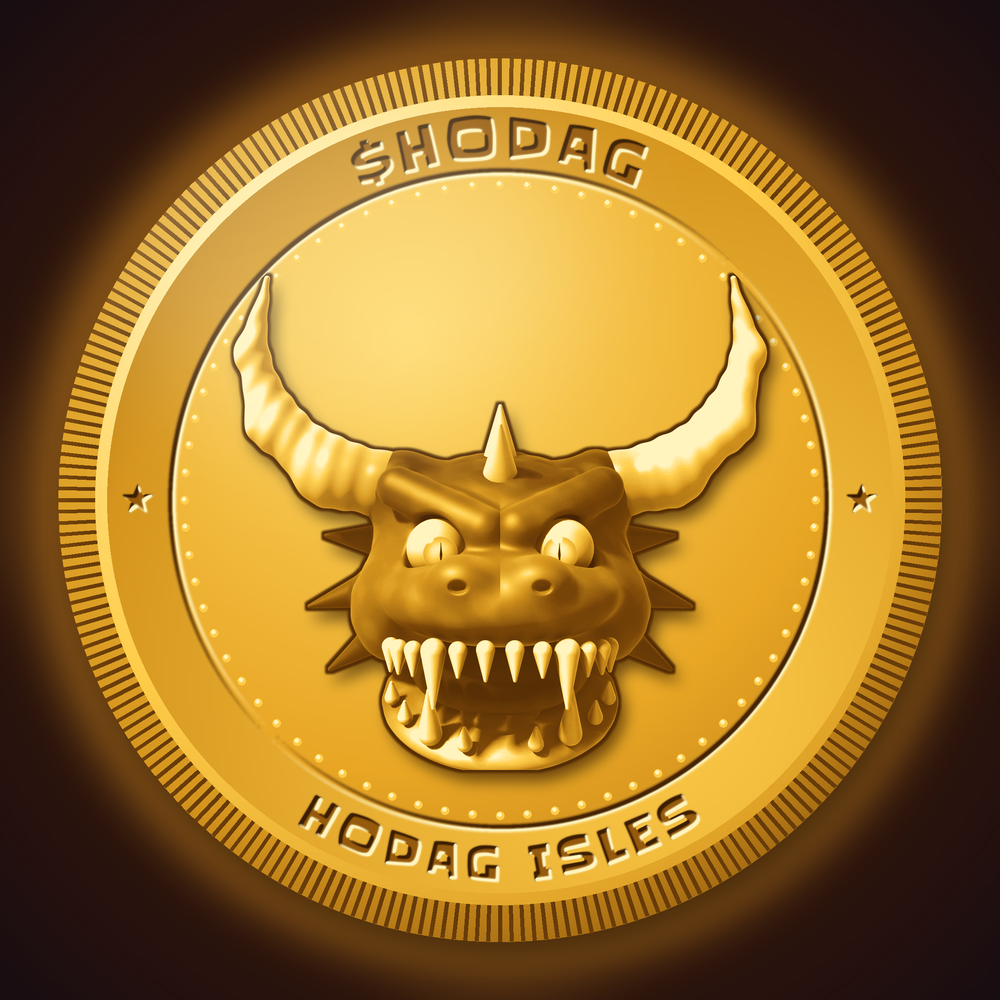
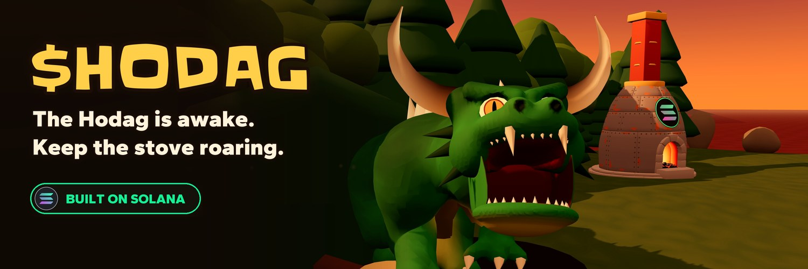

# Media Kit

Making a video, a thread or fan art? Use these.

## Logo

<figure><figcaption>
Hodag Isles
</figcaption></figure>

<figure><figcaption>
Icon (profile pictures, app icons)
</figcaption></figure>

<figure><figcaption>
The $HODAG coin (token only)
</figcaption></figure>

## Colours

| Name | Hex | Use |
|---|---|---|
| Stove gold | `#FFCF4A` | Titles, highlights |
| Solana purple | `#9945FF` | Anything Solana |
| Solana green | `#14F195` | Anything Solana (with purple) |
| Ember ink | `#1C0E06` | Outlines, dark panels |
| Campfire cream | `#FFF3DC` | Body text on dark |
| Hodag green | `#3F8A2E` | The beast |

## Fonts

All free from Google Fonts:

* **Slackey** for titles
* **Gantari** for body text and buttons
* **Knewave** for accents

## Lines you can use

* Keep the stove roaring. The Hodag is watching.
* They cut the wrong tree.
* It's awake.
* Play free in your browser · Built on Solana


Use the Solana mark only to say Hodag Isles is built on Solana. Don't suggest that Solana endorses the project.

