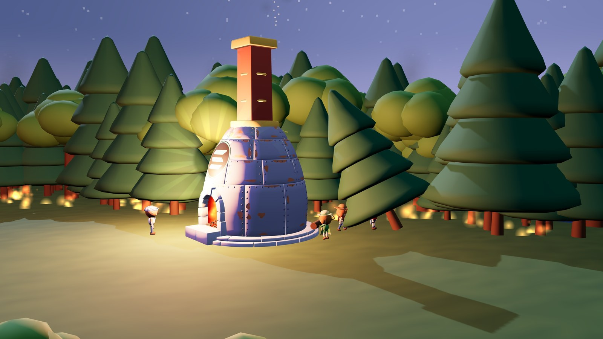

# Feed the Big Stove

While the Big Stove roars, the Hodag keeps its distance. When it cools, the beast comes closer. So the whole camp feeds it together.

## What burns

| Fuel | Where it comes from | How well it burns |
|---|---|---|
| **Logs** | Chop at the log piles | Good |
| **Bundles** | Three logs of one wood, sawn at the Big Woods Sawmill | Better |
| **Coal** | Dug in John Henry's Tunnel | Best |

## How to feed it

1. Pick up a log with **E**.
2. Carry it to the Big Stove (the iron dome with the glowing three-bar Solana mark).
3. Hold the mouse button to aim, then let go to throw it into the fire door.


Coal burns brightest. Bundles of one wood beat loose logs. The camp shares one fire, so every log you throw helps everyone in the room.

