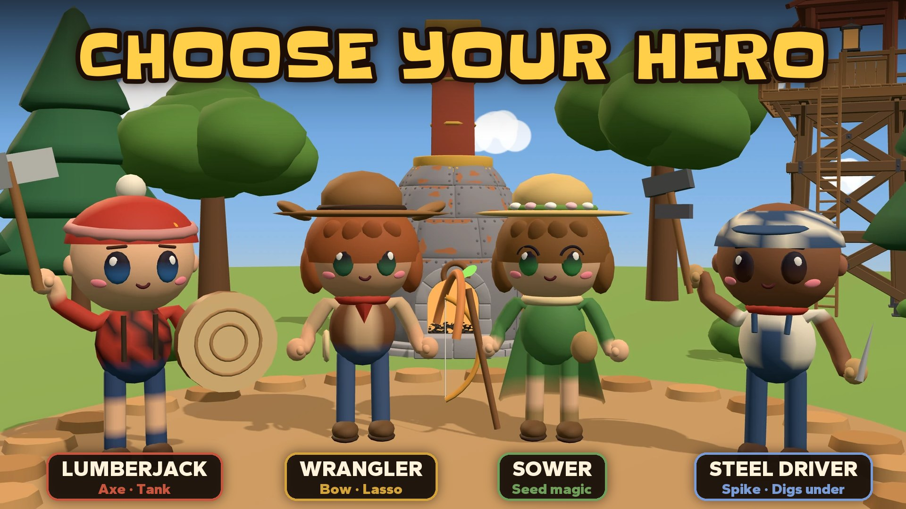

# Choose Your Hero

Walk to a glowing stone at the **Legend Statues** to pick your hero. New loggers start as the Lumberjack; the others unlock after **10 minutes of play or 1 win**.

## 🪓 The Lumberjack

*"First into the timber, last to step back."*

Double-bit axe and a shield cut from a log end. A tough close fighter, and the hero who can **climb the Hodag**.

## 🤠 The Wrangler

*"Roped a cyclone once. A Hodag is next."*

The calling of Pecos Bill. A bow for range and a lasso throw that pulls you forward.

## 🌱 The Sower

*"Plant a seed. Mind where it lands."*

The calling of Johnny Appleseed. A crook and seed magic that lifts rocks, and even other players, with roots.

## 🔨 The Steel Driver

*"Watch the ground, not the trail."*

The calling of John Henry. Hammer and spike. Tunnels under the ground and comes up behind you.
