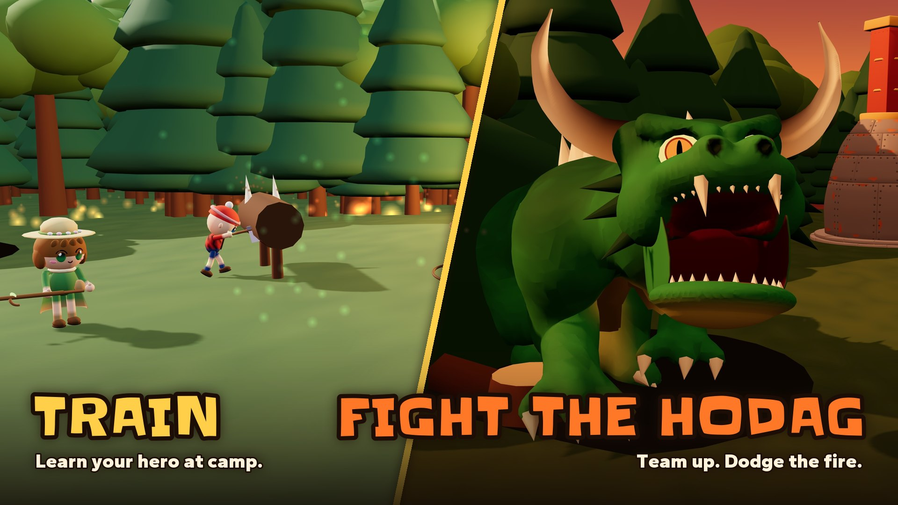
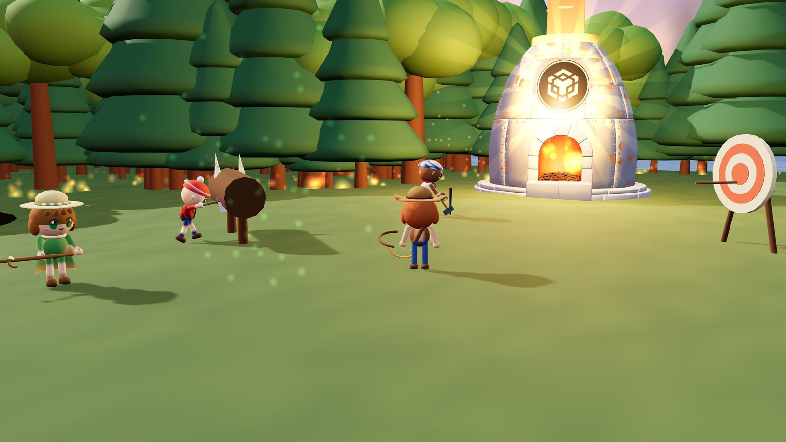

# Fight the Hodag

## Train first

The crew built the **Log Hodag** out of timber so greenhorns can practise. Learn your hero's swings, shots and moves on it before you face the real beast.

## Into Hodag Hollow

Gather your crew at the gate to **Hodag Hollow**, the beast's lair. The Great Hodag doesn't fight fair:

* 🔥 **Fire breath** sweeps the ground in front of it.
* 🟥 **Red rings** show where its tail is about to land. Walk out before the ring fills.
* 🔥 **Burning ground** stays hot for a while after a volley. Don't stand in it.

## Climb the beast

The Lumberjack can **climb the Hodag**: press **R** by its claws, feet or tail, follow the mark up to its **eye** and stab. Hold through the hit; hotter strikes do more damage, but red gets you thrown. **Space** lets go, and you fall stunned.


Go in together. The Hodag hits hard, and a crew that spreads out and covers each other lasts far longer.

