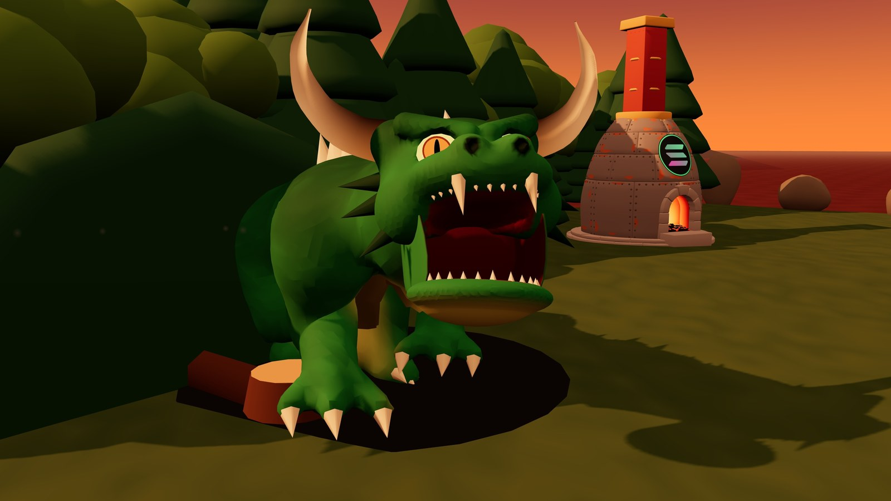

# Creatures

## The Great Hodag

The boss of the isles. Horned head, spiked back, thick tail. It breathes fire, swats with its tail and leaves burning ground behind it. It fears only the glow of the Big Stove.

The Hodag is a real legend: loggers in Rhinelander, Wisconsin, told stories about it in the 1890s.

## The Log Hodag

A training beast the crew built from logs, so greenhorns can practise before the real fight.

## Stumplings

Small, cheeky tree stumps that woke up when the crew started chopping: a sprout of leaves on top, stubby root feet. You can carry them, stack them on your head, throw them, bowl with them and keep them as pets. They don't seem to mind. Probably.

## The Goofang

The giant fish of the Big Lake. It swims backwards to keep the water out of its eyes. A rare catch.

## The Squonk

A weeping little critter who begs for coins by the stove. Feed him and he tells you secrets. See [Feed the Squonk](../solana/squonk.md).
