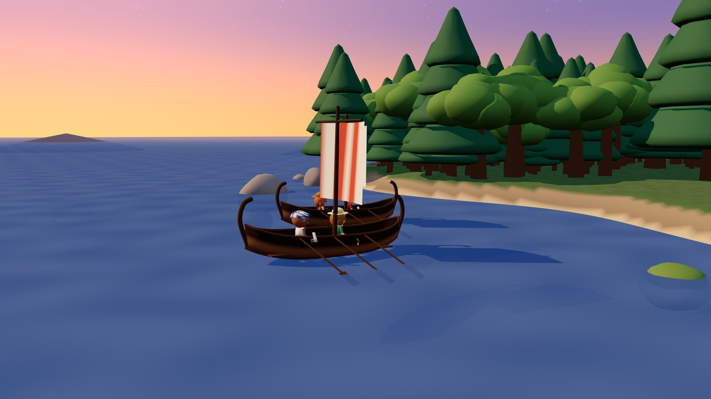
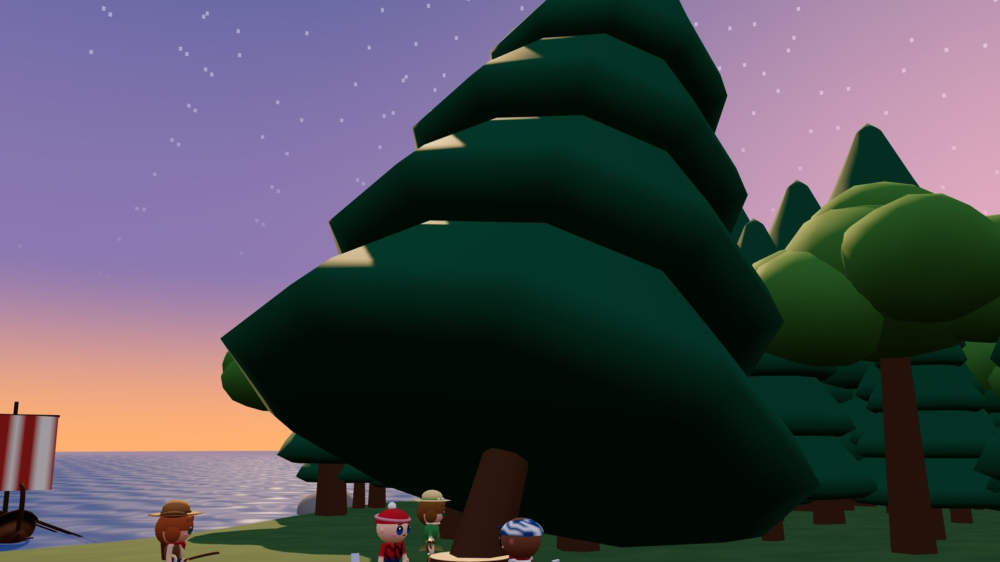
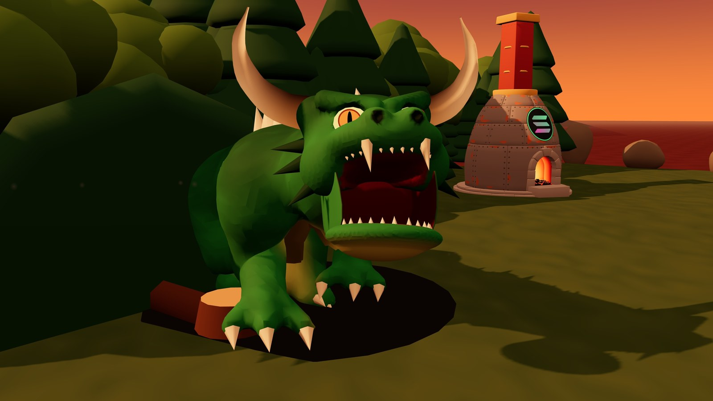
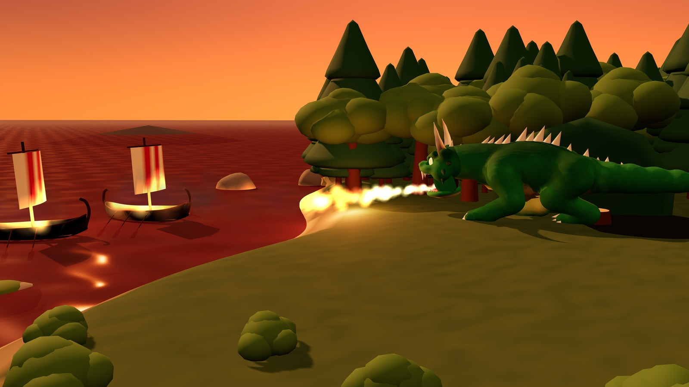
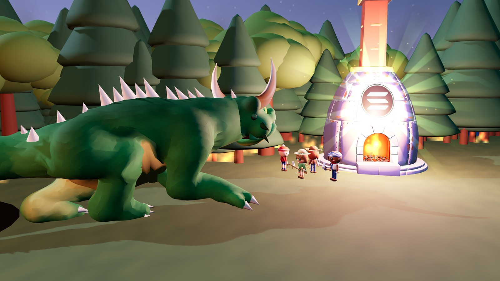

# The Tall Tale

Pull up a stump, greenhorn. This is a true story. Mostly true. Okay, it's a tall tale, but the best ones always are.

## The wrong tree

Paul Bunyan's logging crew sailed across the Big Lake to a chain of wild islands, looking for the tallest timber in America.

They found the tallest tree anyone had ever seen. Somebody said "don't." Somebody else swung the axe.

## The Hodag wakes

Under the roots of that tree slept the **Great Hodag**: horns, a spiked back, a tail like a battering ram and breath like a forest fire.

It woke furious. It roared once, then turned every boat into charcoal and ringed the isles with fire and smoke.

No boats. No way home. Paul went for help, and Paul has not come back.

## The one thing it fears

Deep in the woods the crew found Paul's camp stove, the **Big Stove**: as tall as a barn, riveted iron, with a chimney you could lose a moose in. Above the fire door shines the three-bar **Solana** mark.

When the stove roars, the mark blazes purple to green, and the Hodag can't stand the light. It rears back and runs into the trees.

So the crew has one job: **keep the stove roaring.**

## The story so far

| Act | What happens |
|---|---|
| **1. Washed ashore** | You crawl out of a wrecked boat. Sourdough Sam, the camp cook, puts a log in your arms and points at the Big Stove. |
| **2. Camp life** | You meet the legends and learn their trades: sawing, hauling, digging, fishing, planting. At the legend statues you pick your hero. |
| **3. The stirring** | The Hodag grows restless. Crews pick sides. Big Ole opens the Brawl Pit so the camp can learn to fight. |
| **4. Fight back** | You train on the Log Hodag, walk into Hodag Hollow, climb the beast and strike its eye. |

Each season can end the tale a different way: the boats rebuilt, Paul's return, or a second beast. The story keeps going.


Every character and creature in Hodag Isles comes from American folklore in the public domain, or is our own invention. The Hodag itself is a real legend from Rhinelander, Wisconsin.

