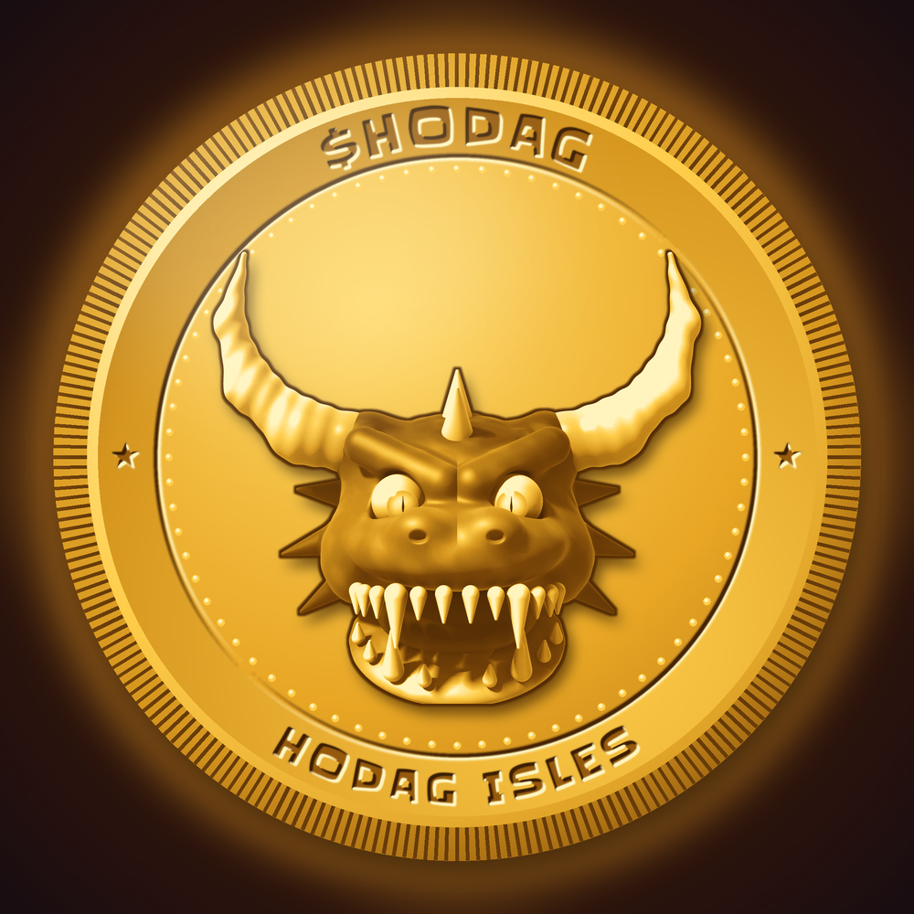

# The Hodag Coin

<figure><figcaption>
The Hodag Coin
</figcaption></figure>

## The legend

One night the Big Stove roared hotter than ever, and its golden BNB mark blazed so bright the Hodag reared back into the trees. Big Ole the blacksmith pulled a bar of gold from the glow and struck the first coin. On its face: the horned head of the Great Hodag. Around the rim Johnny Inkslinger engraved **$HODAG** and **HODAG ISLES**.

*"So nobody forgets what we're up against. And so nobody forgets we're still here."*

## The token

| | |
|---|---|
| **Name** | Hodag Isles |
| **Ticker** | $HODAG |
| **Chain** | BNB Smart Chain |
| **Launchpad** | [flap](https://flap.sh/bnb/0x190e79baf5b53616862df67733ba80e9d4857777) |
| **Contract (CA)** | `0x190e79baf5b53616862df67733ba80e9d4857777` |
| **BscScan** | [View the token](https://bscscan.com/token/0x190e79baf5b53616862df67733ba80e9d4857777) |

$HODAG is the coin of the Hodag Isles community. Players earn it in the game before launch (see [Earn Before Launch](earn.md)), and rewards are paid in $HODAG on BNB Chain after launch.


The only official $HODAG contract is **`0x190e79baf5b53616862df67733ba80e9d4857777`**. Always check the full address before you buy: fake tokens with the same name will appear.



$HODAG is a meme coin made for fun and for the community. It has no promise of value or returns. Only spend what you're happy to lose.

